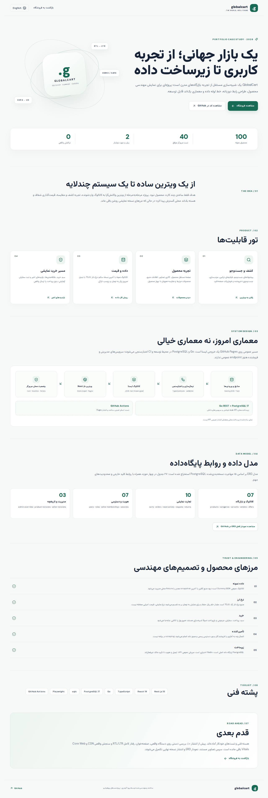

# GlobalCart — Intelligent Global Marketplace

<p align="center"><a href="https://pooya-labs.github.io/pooya-labs-platform/" aria-label="Pooya Labs Platform — official portfolio"></a></p>

**Portfolio project 06 · Independent repository**  
**Personal owner / creator:** [Pooya Goodarzi](https://github.com/pooya-labs)  
**Official portfolio and project gateway:** [Pooya Labs Platform](https://pooya-labs.github.io/pooya-labs-platform/)  
**Source repository:** https://github.com/pooya-labs/globalcart  
**Public preview:** https://pooya-labs.github.io/globalcart/  
**Bilingual case study:** https://pooya-labs.github.io/globalcart/case-study/


<details>
<summary>Desktop — full-page case-study capture</summary>



</details>

<details>
<summary>Mobile — full-page case-study capture</summary>


</details>

GlobalCart is a commerce-grade marketplace **simulation** built to demonstrate product engineering: responsive retail UX, catalog ingestion, localization, pricing, discovery, shopping flows, dashboards, automated quality checks and deployment. The stable v1.0.0 portfolio/demo release is published at [GitHub Releases](https://github.com/pooya-labs/globalcart/releases/tag/v1.0.0); implementation and verification history are tracked in [ROADMAP.md](ROADMAP.md). It is not a live retailer. No real goods are sold and no real payment, inventory reservation, shipment, seller payout or money refund is processed. Returns/refunds exist only as an internal demo state machine.

## Current status — v1.0.0 stable portfolio/demo release · 2026-11-08

**Published release:** [GlobalCart 1.0.0](https://github.com/pooya-labs/globalcart/releases/tag/v1.0.0) is live. Tag `v1.0.0` points to [`dfe9a98`](https://github.com/pooya-labs/globalcart/commit/dfe9a98c70a9bbde3f5444c6f2cad2abd74269ac).

**Release verification:** the official release workflow [run 42494416761](https://github.com/pooya-labs/globalcart/actions/runs/42494416761) published the stable tag after TypeScript, unit tests, production build, cross-browser Playwright/axe (**151 passed / 9 intentional skips / 0 failed**), historical secret scan and public route smoke passed. Post-release merged-main Browser E2E [42516946135](https://github.com/pooya-labs/globalcart/actions/runs/42516946135) passed (**163 passed / 9 intentional skips / 0 failed**); the guarded release preflight [42518896659](https://github.com/pooya-labs/globalcart/actions/runs/42518896659) correctly skipped duplicate publication because v1.0.0 already exists.

**Latest complete public quality gate:** [Lighthouse run 42517087881](https://github.com/pooya-labs/globalcart/actions/runs/42517087881), attempt 2, passed all six route/mode reports with unchanged budgets. Mobile Performance: home 96, product 96, case study 99; desktop Performance 100 on all three. Mobile TBT was 174 / 130 / 121 ms and LCP 2.4 / 2.5 / 0.9 s (home / product / case study). Accessibility, Best Practices and SEO are 100 in every report; CLS is 0 throughout. Earlier 320/303 ms home-mobile outliers are retained as lab variance; no budget was relaxed.

**Companion verification:** latest mainline Security [42518528453](https://github.com/pooya-labs/globalcart/actions/runs/42518528453), Pages deployment [42518528466](https://github.com/pooya-labs/globalcart/actions/runs/42518528466), live desktop/mobile QA [42518731820](https://github.com/pooya-labs/globalcart/actions/runs/42518731820) and Shopify Catalog Smoke [42518731796](https://github.com/pooya-labs/globalcart/actions/runs/42518731796) passed.

**QA boundary:** GlobalCart is a stable portfolio/demo simulation, not a live retailer. The owner confirmed real desktop/mobile review, an actual platform screen-reader pass and full human RTL/LTR review on 2026-11-08. Eligible normal-network/CDN field Core Web Vitals have not been collected and are not inferred from Lighthouse lab reports. Product amounts remain illustrative estimates and cart/checkout are simulations. No real payments, inventory reservation, fulfillment or seller payouts are enabled.

Implemented:
- Next.js 15 App Router, React 19 and TypeScript.
- Responsive marketplace storefront with Persian RTL and English LTR, category-first navigation and refreshed retail design system.
- Catalog-driven category mega-menu and quick-category navigation with counts derived from the embedded 1,000-item catalog.
- Product detail pages are statically generated for the 1,000-item local catalog and styled as native GlobalCart listings; product cards and titles open the in-store detail page, with no outbound marketplace/product links.
- Multi-image product galleries retain the main image and every alternate image supplied by the catalog record, with thumbnail selection and previous/next controls.
- Original catalog photography is downloaded server-side, optimized to responsive WebP assets and self-hosted under `public/images/catalog/`; the browser never calls the upstream image host.
- Persistent side-by-side comparison for up to four products.
- Three deliberately curated homepage collections (workspace, audio/connectivity and everyday carry) with 12 selected catalog items and reviewed Persian names/short descriptions; original source titles remain available for transparency.
- Guided empty states for the bag, favorites and search, repeated no-real-payment notices, and TGJU freshness beside converted product and cart prices.
- Marketplace service shortcuts and a transparent FAQ covering product sourcing, demo limits and support.
- Offline-first product catalog: a balanced 1,000-item subset of the Amazon Berkeley Objects dataset is committed to the repository with locally hosted, high-resolution WebP image galleries. Search, category filters, product cards and static detail routes work without a runtime Shopify or catalog-provider request.
- Storefront shell, typography, category navigation and product-card geometry render independently of image downloads; product imagery uses reserved aspect-ratio boxes, lazy loading and low fetch priority so slow photos do not block the page.
- The ABO source provides product metadata and images, but no seller sale prices, ratings or stock in the selected fields. GlobalCart generates stable, category-bounded USD demo estimates (`priceKind: estimated`) while keeping `priceAvailable: false`; estimates are never represented as retailer quotes. Ratings and stock remain unlisted. Dataset attribution and CC BY 4.0 details are documented in [data/CATALOG_SOURCE.md](data/CATALOG_SOURCE.md).
- Typed catalog normalization, validation, source identity, timestamps and deduplication foundation.
- Search, category filtering, price range, sorting, quick view, favorites and recently viewed.
- Browser-local cart, quantity changes, removal and simulated checkout.
- TGJU free-market USD quote for demo price estimates; the source publishes Rial and GlobalCart explicitly converts it to Toman. Source time and freshness are labelled; no hard-coded FX fallback is used.
- Decimal-safe pricing core using integer cents, fixed-point FX and explicit rounding.
- Source/demo disclosures and visible owner attribution.
- GitHub Pages deployment workflow, project handoff documentation and a bilingual portfolio case study with architecture/data-flow view and a 27-table PostgreSQL ERD.
- Real desktop/mobile full-page case-study screenshots are committed in `docs/screenshots/`.
- Search suggestions, keyboard command palette, rating-based catalog ranking and saved-search flows. The command palette and cart/favorites/quick-view/compare/demo-checkout dialogs are interaction-loaded; cross-browser E2E verifies lazy loading and focus restoration.
- Backend foundation: Go REST/OpenAPI, PostgreSQL 17 and sqlc are available for local development and CI. Redis is optional; no hosted business API or database is deployed. The only hosted Worker is a narrow public-catalog proxy.
- Automated axe checks, keyboard focus tests, desktop/mobile Playwright journeys and first-party asset budgets run in CI. The M09.3 screenshot-capture checkpoint passed 40/40 Browser E2E scenarios in [run 41596731945](https://github.com/pooya-labs/globalcart/actions/runs/41596731945).

Boundaries and remaining work:
- Translation is intentionally paused and excluded from CI; original source product text is displayed.
- The storefront does not link customers out to upstream product pages and does not treat the licensed reference catalog as live retailer inventory. Displayed amounts are deterministic GlobalCart estimates, not seller prices; source price, ratings and stock remain unverified or unlisted. A future real-seller feed requires a separate authorized integration and terms review. Automated TGJU page retrieval remains subject to the source site's terms and availability.
- Internal admin and seller services through M06.6 (seller profile and aggregate demo analytics) are implemented and CI-verified. Their dashboard UI, public routes and account-backed order history remain gated by approved hosting and identity infrastructure; cart, checkout, returns and refunds remain simulations/internal services, not live commerce.
- Automated axe/WCAG coverage includes storefront, product detail, recently viewed (populated/empty in both locales), case study and key dialogs. Browser E2E [41652758312](https://github.com/pooya-labs/globalcart/actions/runs/41652758312) passed **99 tests** with **4 intentional skips** across Chromium desktop/mobile, iPad 7th-gen tablet, Firefox and WebKit. Tablet portrait/landscape checks (810×1080 and 1080×810) verify storefront/product/case study have no horizontal overflow; compact-phone checks (320 px and 360 px) cover the same routes. The WebKit dual-locale axe test now passes within its 60 s allowance without a retry.
- Owner-confirmed manual QA on real desktop/mobile devices, an actual platform screen reader and full human RTL/LTR is complete (2026-11-08). Eligible normal-network/CDN field Core Web Vitals remain unmeasured and optional; browser/Lighthouse lab measurements are not represented as field data.

## Demo boundaries

| Area | Current behavior |
|---|---|
| Product catalog | A committed local snapshot with 1,000 real listings selected from the ABO dataset; category and search filters run locally. |
| Product pages | Every product has its own static GlobalCart detail route. Alternate photos are available in a thumbnail/arrow gallery; no outbound product link is presented. |
| Images | Original source imagery is normalized to responsive WebP and stored under `public/images/catalog/`; card, thumbnail and detail images load lazily after the layout is painted. |
| Pricing / availability | Stable category-based GlobalCart demo estimates are displayed separately from source provenance. ABO seller prices, ratings and stock are not provided; no live price or stock claim is made. |
| Translation | Paused; original source text is preserved |
| Currency | TGJU free-market USD page, Rial converted to Toman; indicative, not an executable quote |
| Cart / favorites | Local browser state; product records are not sent to a server. |
| Checkout | Local simulation; never contacts a payment provider or merchant checkout. |
| Inventory / shipping | Not represented as live inventory; GlobalCart does not reserve stock, ship or fulfill goods. |

Amazon's public storefront must not be scraped or bulk-copied. Any future adapter requires verified program/API eligibility and compliance with current content, image, price-refresh, attribution and linking rules. Affiliate product discovery is not an unrestricted catalog feed.

**Catalog source boundary:** the active offline storefront uses the committed 1,000-item Amazon Berkeley Objects snapshot and locally hosted image galleries. Shopify Global Catalog remains a separate Cloudflare Worker integration/smoke-test path; it is not the active storefront catalog source. No Shopify merchant offer is persisted in the local catalog. The cart and checkout remain simulations. Architecture and source constraints are documented in [docs/REAL_CATALOG_MIGRATION.md](docs/REAL_CATALOG_MIGRATION.md).

## Technology

- **Languages:** TypeScript, CSS, Go and SQL (with HTML rendered through React).
- **Framework:** Next.js 15 / React 19.
- **UI:** custom responsive design system, Lucide icons.
- **Hosting:** GitHub Actions + Next.js static export on GitHub Pages. A separate Cloudflare Worker exposes a validated, no-cache Shopify Global Catalog integration path for smoke testing; it is not used as the active storefront feed.
- **State:** React state for the local ABO snapshot and storefront interactions; the full snapshot is loaded on demand near the catalog or when users interact. Browser localStorage holds demo-only cart, favorites, locale, search and recently-viewed references.

This repository is deliberately independent. It has no runtime, deployment or package dependency on any other portfolio project.

## Run locally

Requirements: Node.js 20.9+ and npm.

```bash
git clone https://github.com/pooya-labs/globalcart.git
cd globalcart
npm install
npm run dev
```

Open http://localhost:3000.

```bash
npm run typecheck
npm run build
```

## Documentation and handoff

- [ROADMAP.md](ROADMAP.md) — milestone checklist, acceptance criteria and release ledger.
- [Bilingual case study](https://pooya-labs.github.io/globalcart/case-study/) — product story, feature tour and architecture overview.
- [PROJECT_CONTEXT.md](PROJECT_CONTEXT.md) — current implementation state and next action.
- [docs/AI_HANDOFF.md](docs/AI_HANDOFF.md) — mandatory instructions for a replacement AI/developer.
- [CHANGELOG.md](CHANGELOG.md) — version history.
- [docs/ARCHITECTURE.md](docs/ARCHITECTURE.md) — system boundaries and data flow.
- [docs/DATABASE_ERD.md](docs/DATABASE_ERD.md) — migration-derived PostgreSQL ERD covering all 27 tables and key constraints.
- [docs/PERFORMANCE_QA.md](docs/PERFORMANCE_QA.md) — public Lighthouse lab baseline, methodology and manual 1.0 release checklist.
- Latest published Lighthouse [42498127131](https://github.com/pooya-labs/globalcart/actions/runs/42498127131): six route/mode reports passed on retry 2. Mobile Performance home 95 / LCP 2.5 s / TBT 200 ms; product 96 / 2.5 s / 140 ms; case study 99 / 0.9 s / 90 ms. Desktop Performance is 100 on all routes. Accessibility, Best Practices and SEO are 100 in all six audits; CLS is 0 throughout. The initial 353 ms home-mobile TBT sample did not reproduce on retry (200 ms); no budget was relaxed. GitHub-hosted lab only, not field Core Web Vitals. Full diagnostics: [docs/PERFORMANCE_QA.md](docs/PERFORMANCE_QA.md).
- [docs/DATA_SOURCES.md](docs/DATA_SOURCES.md) — source provenance and provider policy.
- [docs/REAL_CATALOG_MIGRATION.md](docs/REAL_CATALOG_MIGRATION.md) — requirements and blockers for replacing sample items with real products.
- [docs/DECISIONS.md](docs/DECISIONS.md) — accepted architecture decisions.
- [docs/RELEASE_PROCESS.md](docs/RELEASE_PROCESS.md) — verification and semantic versioning.
- [CONTRIBUTING.md](CONTRIBUTING.md) — engineering rules.

## Versioning

GlobalCart follows semantic versioning. Every release must update package.json, CHANGELOG.md, ROADMAP.md and PROJECT_CONTEXT.md in the same release commit. A roadmap checkbox is only marked complete after implementation and verification. The repository is the source of truth; chat history is not.

**Owned and maintained by [Pooya Labs](https://github.com/pooya-labs) · Created and engineered by Pooya Goodarzi.**


## Backend foundation (local development)
The M04 backend foundation is merged into `main`. It includes a Go REST API, PostgreSQL 17 Docker Compose setup, versioned SQL migrations, sqlc-generated query layer, catalog snapshot importer and OpenAPI 3.1 contract. It remains local-development infrastructure; the public GitHub Pages demo is static and no cloud database or API has been provisioned.

Historical M04 backend CI [41382309964](https://github.com/pooya-labs/globalcart/actions/runs/41382309964), Security scans [41382310050](https://github.com/pooya-labs/globalcart/actions/runs/41382310050) and Pages deployment [41382310024](https://github.com/pooya-labs/globalcart/actions/runs/41382310024) validated that foundation when it was merged; current public Pages checks are tracked in the roadmap. See [backend/README.md](backend/README.md) for local setup and [backend/openapi.yaml](backend/openapi.yaml) for the read-only API contract.


---

## Latest project update — 8 November 2026

The bilingual case study now includes committed desktop and mobile full-page captures. The latest storefront maintenance also persisted the catalog snapshot, lockfile and site imagery in the repository, while a branding fix made the Pooya Labs ownership marks clickable and restored case-study badge contrast. The published v1.0.0 scope and demo-only commerce boundaries above remain unchanged.

## Project ownership

<p align="center"><a href="https://pooya-labs.github.io/pooya-labs-platform/" aria-label="Pooya Labs Platform — official portfolio"></a></p>

**Personal owner and creator: Pooya Goodarzi.** [Pooya Labs Platform](https://pooya-labs.github.io/pooya-labs-platform/) is the official portfolio and project gateway, not a separate legal owner. Third-party assets remain subject to their respective licenses and rights. **Use permission:** Pooya Goodarzi grants everyone a non-exclusive, worldwide permission to use, copy, modify, and redistribute this project's original code and documentation, including for commercial purposes. Ownership of the original work remains with Pooya Goodarzi. This permission does not cover third-party materials, which remain subject to their owners' terms. Pooya Labs Platform and its code, content, and brand assets are expressly excluded and remain reserved exclusively to Pooya Goodarzi.


## راهنمای فارسی

### معرفی

**GlobalCart** یک شبیه‌ساز بازارگاه آنلاین با تجربهٔ فروشگاهی چنددسته‌ای است که برای نمایش مهندسی محصول، تجربهٔ خرید واکنش‌گرا، فهرست کالا، جست‌وجو، فیلترها، بومی‌سازی و جریان‌های سبد خرید ساخته شده است.

### وضعیت انتشار و بازبینی نهایی

نسخهٔ پایدار نمایشی **۱.۰.۰** در تاریخ ۸ نوامبر ۲۰۲۶ منتشر شده و وب‌سایت عمومی روی GitHub Pages فعال است. بازبینی دستی مالک روی دستگاه‌های واقعی دسکتاپ و موبایل، صفحه‌خوان واقعی و رفتار کامل فارسی راست‌به‌چپ / انگلیسی چپ‌به‌راست نیز در همین تاریخ تأیید شده است. Core Web Vitals کاربران واقعی هنوز دادهٔ واجدشرایط ندارد و جزو پیش‌نیاز انتشار نمایشی نیست. جزئیات آزمون‌ها و شواهد کیفیت در بخش انگلیسی README و مستندات مخزن ثبت شده‌اند.

### امکانات نسخهٔ نمایشی

- کاتالوگ محلی شامل ۱۰۰۰ فهرست کالا بر پایهٔ snapshot مجموعه‌دادهٔ Amazon Berkeley Objects.
- صفحهٔ مستقل برای هر محصول و گالری تصاویر جایگزین.
- جست‌وجو و فیلتر دسته‌بندی‌ها در مرورگر.
- تصاویر WebP میزبانی‌شده در خود مخزن و بارگذاری تنبل پس از آماده‌شدن چیدمان صفحه.
- نمایش برآوردهای نمایشی قیمت به‌صورت جدا از اطلاعات منبع؛ قیمت، موجودی و امتیاز فروشندهٔ زنده ادعا نمی‌شود.
- سبد خرید، علاقه‌مندی‌ها، زبان و تاریخچهٔ مشاهده به‌صورت محلی در مرورگر.
- شبیه‌سازی فرایند پرداخت بدون ارتباط با درگاه بانکی یا فروشنده.

### مرزهای مهم داده و تجارت

این پروژه فروشگاه واقعی نیست؛ کالا رزرو یا ارسال نمی‌شود و موجودی زنده‌ای نگهداری نمی‌شود. قیمت‌های نمایشی، قیمت قابل معامله یا پیشنهاد خرید محسوب نمی‌شوند. نسخهٔ عمومی به پایگاه داده یا API ابری متصل نیست. زیرساخت Go و PostgreSQL موجود در مخزن برای توسعهٔ محلی است و نباید آن را سرویس backend مستقرشدهٔ سایت عمومی تلقی کرد.

### فناوری‌ها

TypeScript، CSS، Go، SQL، Next.js، React، GitHub Actions و GitHub Pages. بخش رابط فروشگاه از state محلی مرورگر استفاده می‌کند.

### اجرای محلی

به Node.js نسخهٔ ۲۰٫۹ یا جدیدتر و npm نیاز دارید:

```bash
git clone https://github.com/pooya-labs/globalcart.git
cd globalcart
npm install
npm run dev
```

برای بررسی و ساخت نسخه:

```bash
npm run typecheck
npm run build
```

### مستندات و ادامهٔ مسیر

برای نقشهٔ راه، معماری، منابع داده، راهنمای تحویل به توسعه‌دهندهٔ بعدی، ERD و گزارش آزمون کارایی به فایل‌های `ROADMAP.md`، `PROJECT_CONTEXT.md`، `docs/AI_HANDOFF.md`، `docs/ARCHITECTURE.md` و سایر پیوندهای بخش انگلیسی README مراجعه کنید.

### آخرین تغییرات — ۸ نوامبر ۲۰۲۶

برای مطالعهٔ موردی دوزبانه، تصاویر کامل صفحه در اندازه‌های دسکتاپ و موبایل به مخزن اضافه شدند. snapshot کاتالوگ ۱۰۰۰ محصولی و ۲۴ دسته، lockfile و تصاویر سایت در مخزن ثبت شده‌اند. نشان‌های مالکیت پویا لبز به وب‌سایت رسمی پیوند دارند و کنتراست نشان مطالعهٔ موردی اصلاح شده است. بارگذاری پالت فرمان و پنجره‌های سبد، علاقه‌مندی، مقایسه و پرداخت نمایشی نیز تا زمان تعامل کاربر به تعویق افتاده و آزمون‌های مرورگر موفق بوده‌اند.

### مالکیت و نگه‌داری

<p align="center"><a href="https://pooya-labs.github.io/pooya-labs-platform/" aria-label="درگاه رسمی پلتفرم پویا لبز"></a></p>

**مالک شخصی و پدیدآورنده: پویا گودرزی.** [پلتفرم پویا لبز](https://pooya-labs.github.io/pooya-labs-platform/) درگاه رسمی معرفی پورتفولیو و پروژه‌هاست و مالک حقوقی جداگانه‌ای نیست. دارایی‌های اشخاص ثالث تابع مجوز و حقوق صاحبان آن‌ها هستند. **اجازهٔ استفاده:** پویا گودرزی به همه اجازه‌ای غیرانحصاری و جهانی برای استفاده، کپی، تغییر و بازنشر کدها و مستندات اصیل این پروژه، از جمله برای مقاصد تجاری، می‌دهد. مالکیت آثار اصیل همچنان متعلق به پویا گودرزی است. این اجازه شامل دارایی‌های اشخاص ثالث نمی‌شود و آن‌ها تابع شرایط صاحبان خود هستند. پلتفرم پویا لبز و کدها، محتوا و دارایی‌های برند آن صراحتاً از این اجازه مستثنا هستند و به‌صورت انحصاری برای پویا گودرزی محفوظ می‌مانند.
