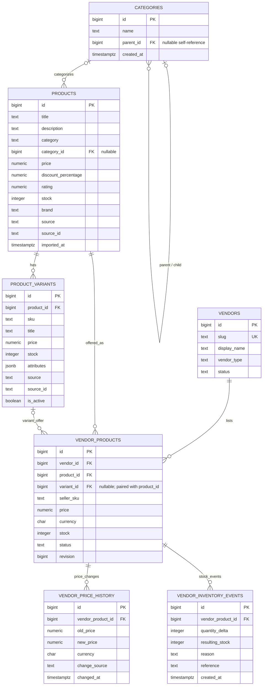
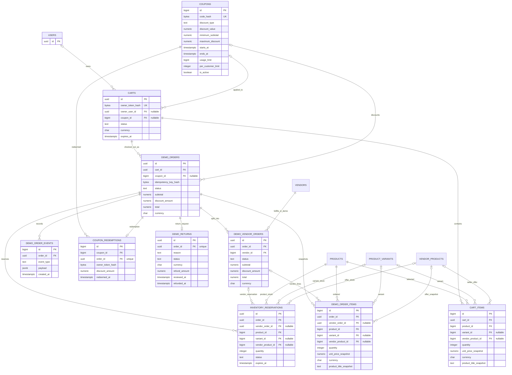
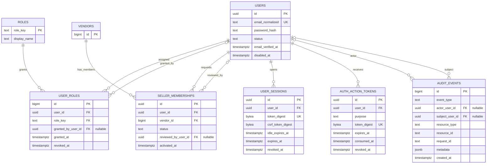
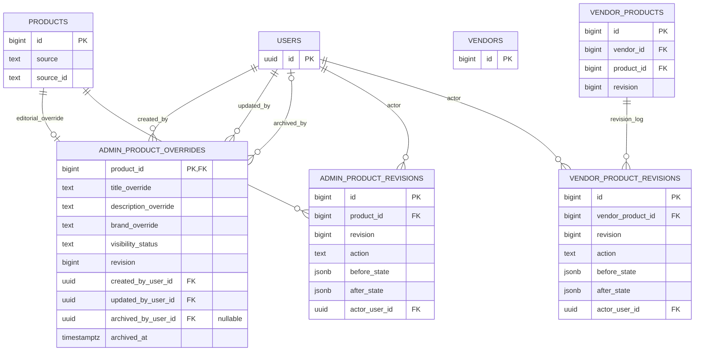

# GlobalCart — PostgreSQL Entity Relationship Diagram

> **Schema source of truth:** the append-only SQL migrations under `backend/internal/database/migrations/`.
> This document reflects migrations **001–015** on `main`; it does not describe a deployed production database.

## Scope and verification

The current schema defines **27 tables across 15 versioned migrations**. The diagrams below are split by domain so the relationships remain readable. They include the foreign-key relationships declared by the migrations; application-level behavior and browser-local state are described separately.

| Domain | Tables | Main responsibility |
|---|---:|---|
| Catalog and marketplace | 8 | Source products, categories, variants, vendors, offers and offer history |
| Demo commerce | 10 | Carts, parent/vendor orders, immutable item snapshots, reservations, coupons, returns and events |
| Identity and access | 7 | Accounts, roles, seller memberships, sessions, one-time tokens and audit events |
| Editorial and offer history | 3 | Admin product overrides/revisions and seller offer revisions |
| **Total** | **27** | |

The counts are table ownership groupings for documentation; shared entities such as `products`, `vendors` and `users` appear as references in more than one diagram but are counted once.

## 1. Catalog and multi-vendor marketplace

**Important constraints**

- A product's normalized `category_id` is optional; the original source `category` text remains on `products`.
- A variant belongs to exactly one product. Variant references from offers use the composite `(variant_id, product_id)` key so a variant cannot be attached to a different product.
- A vendor can have one base offer per product or one offer per variant. Partial unique indexes enforce those two cases independently.
- `vendor_products` owns seller price, currency, stock and lifecycle status. Imported product and variant records retain their source provenance.
- `vendor_price_history` and `vendor_inventory_events` are append-oriented histories linked to the offer; they are not alternative inventory or price sources.

## 2. Demo commerce, coupons and order lifecycle

**Important constraints**

- Carts may be guest-owned through a digest-only `owner_token_hash` or associated with a verified account through nullable `owner_user_id`. Orders do not have a direct `user_id` column; account ownership is resolved through the cart.
- `cart_items` and order/reservation rows support both legacy product/variant lines and vendor-offer lines. Vendor-order and vendor-offer references must be supplied together on order items and reservations.
- Parent orders can split into one child order per vendor. Composite foreign keys ensure each child line/reservation belongs to the same parent order as its vendor child order.
- Product titles and unit prices are snapshots on cart/order lines; those fields preserve the values presented at the time of the demo flow.
- Coupon codes and guest capabilities are stored as hashes, not reusable plaintext secrets.
- `demo_returns` permits at most one full-order return per parent order. Refund outcomes are simulated state changes only.

## 3. Identity, sessions and authorization

**Important constraints**

- Every inserted account receives the `customer` role from a database trigger. Seller and admin grants are separate, audited operations.
- One active grant per user/role and one membership per user/vendor are enforced by unique constraints/indexes.
- Sessions and one-time action tokens persist SHA-256 digests, not raw bearer tokens. Token purposes are limited to email verification and password reset.
- Active seller access is scoped through a vendor membership; membership status is distinct from the user's global role.
- Audit events are append-only at the database boundary. Their metadata is bounded and rejects keys that could carry passwords, tokens, cookies, secrets or card numbers.

## 4. Editorial administration and revision history

**Important constraints**

- Supplier-owned product fields are not overwritten by editorial edits. Admin overrides are stored separately and take precedence only in the effective catalog view; clearing an override returns to the current supplier value.
- Admin revision history and seller offer revision history are append-only. Each revision is tied to its product/offer and actor.
- Seller offer updates advance the offer's optimistic-concurrency revision in a database trigger. Admin edits/archive/restore use expected revisions in the service layer.
- Manual admin-created product IDs use the reserved high range configured by migration 014; the sequence is owned by `products.id`.

## Reading the model correctly

- These are PostgreSQL schema relationships, not a claim that all services are exposed to the public web.
- The Go/PostgreSQL runtime is a local-development and CI foundation. GitHub Pages serves only the static storefront; the admin/seller services and demo-commerce write paths are internal.
- Browser-local favorites, comparison, saved searches, cart state and recently viewed history are not database tables.
- No real payment processor, inventory reservation, shipment, seller payout or money refund is connected.
- Migrations are immutable after application. Add future schema changes as forward-only migrations and follow [DATABASE_MIGRATION_POLICY.md](DATABASE_MIGRATION_POLICY.md).

## Source files

- [001–015 SQL migrations](../backend/internal/database/migrations/)
- [Backend architecture](ARCHITECTURE.md)
- [Migration and recovery policy](DATABASE_MIGRATION_POLICY.md)
